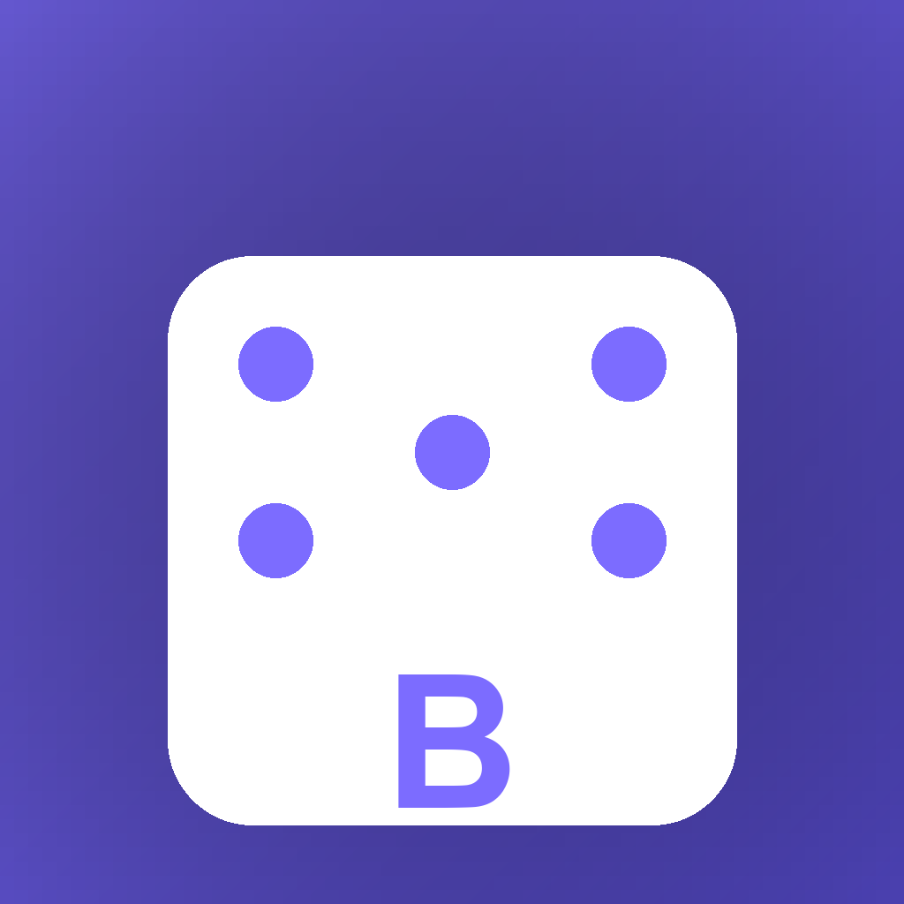

<div align="center">
  <h1>Boredom: Ubah Rasa Bosan Jadi Misi</h1>
  <p><b>Ketuk satu tombol, dapat satu misi dunia nyata, raih XP, naik level.<br/>
  Game mungil untuk kehidupan sehari-hari, sepenuhnya offline.</b></p>

  

  <a href="https://github.com/nekonaru/boredom/releases"></a>
  <a href="https://github.com/nekonaru/boredom/actions/workflows/build-apk.yml"></a>
  
  
  
  
</div>

<br />

[English](README.md) | **Bahasa Indonesia**

> [!NOTE]
> Boredom berjalan sepenuhnya offline. Semuanya (XP, level, streak, riwayat, achievement, misi kustom, favorit) disimpan secara lokal di ponselmu, dan cadangan bekerja dengan menyalin teks, tidak pernah dengan mengunggah.

---

## Daftar Isi

- [Tentang](#tentang)
- [Fitur](#fitur)
- [Persyaratan](#persyaratan)
- [Instalasi](#instalasi)
- [Penggunaan](#penggunaan)
- [Bahasa Tampilan](#bahasa-tampilan)
- [Struktur Proyek](#struktur-proyek)
- [Pengembangan](#pengembangan)
- [Pengujian](#pengujian)
- [Continuous Integration](#continuous-integration)
- [FAQ](#faq)
- [Penulis](#penulis)
- [Lisensi](#lisensi)

---

## Tentang

**Boredom** adalah game Flutter mungil untuk kehidupan sehari-hari, bukan aplikasi produktivitas. Pilih **mood**, **waktu luang**, **lokasi**, dan **energi**, ketuk **I'M BORED**, dan dapatkan satu misi konkret yang bisa kamu lakukan sekarang juga (bukan nasihat umum). **Terima** misinya untuk XP, atau **reroll** (3x per hari) kalau tidak cocok. XP menaikkan levelmu lewat gelar-gelar absurd, dari "Bored" sampai "The Final Boss of Boredom".

Ada juga **Chaos Mode**, yang mengabaikan semua filter sehingga apa pun bisa muncul.

> _"Kamu lagi bosan. Jadi... sekarang ngapain?"_

---

## Fitur

### Misi

| Fitur | Deskripsi |
|-------|-----------|
| **Generator misi** | Misi acak dari katalog 55 misi, disesuaikan dengan mood, waktu, lokasi, dan energi, diberi bobot ke kategori yang paling jarang dimainkan, dengan misi musiman dan fallback cerdas sehingga kamu selalu dapat satu |
| **Chaos Mode** | Mengabaikan semua filter, membuka misi khusus chaos |
| **Terima / reroll** | Terima misi untuk XP, reroll hingga 3x per hari |
| **Quick wins** | Persempit hasil ke misi berdurasi 15 menit atau kurang |
| **Inbox** | Simpan misi untuk nanti dan putar saat kamu siap |
| **Misi kustom** | Buat misimu sendiri dengan hadiah XP sesukamu |
| **Favorit** | Sematkan misi katalog agar mudah ditemukan lagi |
| **Dislike** | Beri downvote pada misi agar generator berhenti memunculkannya |
| **Bisukan kategori** | Matikan satu kategori penuh saat kamu tidak tertarik |

### Progres dan Hadiah

| Fitur | Deskripsi |
|-------|-----------|
| **Pelacakan hasil** | Katakan apakah kamu benar-benar melakukannya: selesai, sebagian, atau dilewati. Sebagian dibayar 60 persen, dilewati tidak dibayar dan tidak pernah memajukan streak-mu |
| **XP dan level** | Kurva progresif dengan gelar level yang absurd, XP ganda setiap akhir pekan |
| **Streak** | Streak harian plus streak terpanjang, dengan masa tenggang 1 hari, token freeze, dan peringatan saat terancam putus |
| **Bonus milestone** | XP tambahan setiap kali melewati batas 10 level |
| **Quest chain** | 4 alur multi-langkah ("Touch Grass Arc", "Creator Arc", "Reset Arc", "Deep Work Arc") dengan hadiah akhir besar |
| **Achievement** | 29 achievement, berbasis progres dan berbasis kejadian (seperti "Night Owl") |
| **Tantangan harian** | Satu tantangan khusus per hari, sama untuk semua orang pada tanggal yang sama, hadiah XP besar |

### Statistik dan Riwayat

| Fitur | Deskripsi |
|-------|-----------|
| **Statistik follow-through** | Persentase misi terlacak yang benar-benar kamu jalankan, ditampilkan sebagai tanda strip sampai data tersedia |
| **Statistik** | Grafik 7 hari dan 30 hari terakhir yang digambar tanpa dependensi, rata-rata XP per hari aktif, hari tersibuk, distribusi per kategori, total reroll dan chaos |
| **Rekap mingguan** | Misi, XP, dan streak terlihat langsung di Home |
| **Insight mingguan** | Apa kata riwayatmu tentang dirimu: dibandingkan minggu lalu, jam produktifmu, kategori yang sering kamu tinggalkan, rata-rata XP. Tidak menampilkan apa pun daripada menebak |
| **Pencarian riwayat** | Filter misi yang selesai berdasarkan judul atau kategori, lalu persempit berdasarkan tanggal (hari ini, 7 hari, 30 hari, semua) dan hasil |
| **Transparansi data** | Riwayat menyebutkan berapa entri yang tersimpan dan berapa yang sedang kamu lihat, tanggal menampilkan tahun bila berbeda, dan favorit yatim bisa dibersihkan |

### Data dan Keamanan

| Fitur | Deskripsi |
|-------|-----------|
| **Undo** | Jendela 5 menit untuk memulihkan penyelesaian terakhir |
| **Undo penuh** | Undo 5 menit untuk misi, tantangan harian, langkah chain, dan misi kustom |
| **Cadangkan dan pulihkan** | Ekspor semua data lokal sebagai teks, impor kembali (ramah ganti ponsel, tanpa akun) |

### Pengingat dan Berbagi

| Fitur | Deskripsi |
|-------|-----------|
| **Pengingat harian** | Satu notifikasi per hari pada waktu pilihanmu, mati secara default |
| **Kartu bagikan** | Render misi mana pun menjadi kartu PNG 1080x1080, atau salin sebagai teks |

### Tampilan dan Nuansa

| Fitur | Deskripsi |
|-------|-----------|
| **Antarmuka Inggris dan Indonesia** | Bahasa Inggris secara default, ganti ke Bahasa Indonesia di Profile |
| **Tema terang dan gelap** | Gelap secara default, mode terang plus 5 warna aksen di Profile |
| **Umpan balik haptic** | Getaran kecil saat mengetuk dan menyelesaikan misi, bisa dimatikan |

---

## Persyaratan

| Dependensi | Versi Minimum | Catatan |
|------------|---------------|---------|
| **Flutter** | 3.47 | Channel stable, hanya diperlukan untuk build dari source |
| **JDK** | 17 | Hanya diperlukan untuk build dari source |
| **Android SDK** | API 34+ | Hanya diperlukan untuk build dari source |
| **Ponsel atau emulator Android** | Android 8.0 (API 26) | Diperlukan untuk menjalankan aplikasi |

> [!TIP]
> Kalau kamu hanya ingin bermain, kamu tidak perlu Flutter, JDK, atau Android SDK. Unduh APK dari halaman [Releases](https://github.com/nekonaru/boredom/releases).

### Belum pernah memakai terminal? Mulai dari sini

<details>
<summary><b>Cara membuka terminal di Windows</b></summary>

1. Tekan tombol **Windows**, ketik `PowerShell`, lalu tekan **Enter**
2. Jendela biru akan terbuka. Di situlah kamu mengetik perintah
3. Setiap perintah `flutter ...` atau `git ...` di panduan ini diketik di jendela itu, diikuti **Enter**

</details>

---

## Instalasi

### Opsi A: Unduh APK (paling mudah)

1. Buka halaman [Releases](https://github.com/nekonaru/boredom/releases)
2. Unduh APK yang sesuai dengan perangkatmu (`app-arm64-v8a-release.apk` untuk kebanyakan ponsel modern, `app-armeabi-v7a-release.apk` untuk ponsel 32-bit yang lebih lama)
3. Buka di ponselmu, izinkan instalasi dari sumber tidak dikenal jika diminta

### Opsi B: Build dari source (untuk pengembangan / membaca atau mengubah kode)

#### 1. Ambil kode proyek

<details>
<summary><b>Saya sudah menginstal Git</b></summary>

```bash
git clone https://github.com/nekonaru/boredom.git
cd boredom
```

</details>

<details>
<summary><b>Saya belum punya Git</b></summary>

1. Buka halaman repositori di GitHub
2. Klik tombol hijau **`Code`**, pilih **`Download ZIP`**
3. Ekstrak ZIP ke folder pilihanmu
4. Di terminal, masuk ke folder hasil ekstrak, contohnya:

```bash
cd Downloads/boredom-main
```

</details>

#### 2. Instal dependensi dan verifikasi

```bash
flutter pub get
flutter analyze
flutter test
```

> [!IMPORTANT]
> `flutter analyze` harus melaporkan **No issues found** dan semua tes harus lulus.

#### 3. Build APK

```bash
flutter build apk --release --split-per-abi
```

Hasilnya ada di `build/app/outputs/flutter-apk/` (`app-arm64-v8a-release.apk` dan kawan-kawannya).

---

## Penggunaan

### Pertama kali dibuka

1. Pilih mood, waktu luang, lokasi, dan energimu
2. Ketuk **I'M BORED**
3. Terima misinya lalu kerjakan, atau reroll (3x per hari)

### Penggunaan sehari-hari

- Buka **Missions** untuk quest chain, misi kustom, favorit, dan riwayat yang bisa dicari
- Cek **Daily Challenge** di Home untuk XP bonus
- Pantau **Stats** untuk grafik mingguan dan rincian kategori
- Ganti bahasa atau cadangkan datamu dari **Profile**

---

## Bahasa Tampilan

Antarmuka aplikasi (menu, tombol, pesan, dan pengaturan) tersedia dalam **English** (default) dan **Bahasa Indonesia**.

1. Buka **Profile**
2. Di bawah **Language**, pilih **English** atau **Bahasa Indonesia**
3. Pilihanmu diingat antar sesi

---

## Struktur Proyek

```
boredom/
├── lib/
│   ├── main.dart                 # entry point, provider, MaterialApp + locale
│   ├── l10n/
│   │   └── app_strings.dart      # tabel Inggris (sumber utama) + Indonesia
│   ├── models/                   # Mission, UserProgress, Achievement, DailyChallenge,
│   │                             # QuestChain, CustomMission
│   ├── providers/                # BoredomProvider (state game), LanguageProvider
│   │                             # ThemeProvider (gelap/terang, aksen)
│   ├── screens/                  # Home, Missions, Stats, Achievements, Profile, shell
│   │                             # onboarding (panduan saat pertama dibuka)
│   ├── services/                 # katalog, generator, penyimpanan lokal,
│   │                             # pengingat, kartu bagikan
│   ├── utils/                    # tema, format tanggal ringan
│   └── widgets/                  # selector chip, mission sheet, bar XP, grafik,
│                                 # ringkasan mingguan, inbox, ...
├── test/
│   ├── widget_test.dart          # aplikasi menyala, onboarding di instalasi baru
│   ├── user_progress_test.dart   # kurva level
│   ├── mission_service_test.dart # fallback generator, filter, pengecualian
│   ├── localization_test.dart    # cakupan string, kewarasan katalog
│   ├── onboarding_test.dart      # flag onboarding tersimpan
│   ├── stats_theme_test.dart     # statistik bulanan, palet, nama hari
│   ├── events_test.dart          # XP akhir pekan, roll musiman, pembobotan
│   └── v24_test.dart             # kategori dibisukan, XP milestone, rekap
├── assets/
│   └── icon/                     # sumber ikon aplikasi (SVG + PNG hasil generate)
├── android_res_extra/            # ikon launcher + splash yang dimasukkan ke APK oleh CI
├── .github/
│   └── workflows/
│       ├── build-apk.yml         # CI: analyze + build APK saat push ke main/master
│       └── release.yml           # rilis: tes + APK terpisah dilampirkan di setiap tag v*
├── pubspec.yaml
├── CHANGELOG.md                  # changelog (Inggris)
├── CHANGELOG.id.md               # changelog (Bahasa Indonesia)
├── LICENSE
├── README.md                     # dokumentasi utama (Inggris)
└── README.id.md                  # dokumentasi (Bahasa Indonesia)
```

---

## Pengembangan

### Menambah string baru untuk pengguna

1. Tambahkan pasangan EN/ID ke `lib/l10n/app_strings.dart` (Inggris dulu)
2. Jika itu konten katalog (misi, achievement, tantangan, langkah chain), tambahkan field `titleId`/`descriptionId` di sebelah field Inggrisnya
3. Gunakan lewat `context.str.yourKey` atau `localizedTitle(en: ..., id: ..., code: ...)`
4. Tidak perlu langkah codegen (`flutter gen-l10n` sengaja tidak dipakai, agar build tetap ringan)

---

## Pengujian

Unit test dan widget test mencakup kurva level, generator misi, dan lokalisasi.

Verifikasi statis sebelum setiap push:

```bash
flutter analyze
flutter test
```

| Pemeriksaan | Syarat |
|-------------|--------|
| `flutter analyze` | Harus melaporkan **No issues found** (nol error, nol warning) |
| `flutter test` | Semua tes harus lulus |

---

## Continuous Integration

| Workflow | Fungsi |
|----------|--------|
| `build-apk.yml` | Analyze dan build APK saat push ke main/master |
| `release.yml` | Tes dan lampirkan APK terpisah di setiap tag `v*` |

Ikon launcher dan splash dari `android_res_extra/` dimasukkan ke APK oleh CI.

Sumber ikon ada di `assets/icon/` (`icon.svg`, `icon_background.svg`, `icon_foreground.svg`); ikon launcher dihasilkan dengan [`flutter_launcher_icons`](https://pub.dev/packages/flutter_launcher_icons) dari PNG master (`assets/icon/icon.png`, `icon_background.png`, `icon_foreground.png`).

---

## FAQ

<details>
<summary><b>Apakah datamu dikirim ke mana-mana?</b></summary>

Tidak. Semuanya (XP, level, streak, riwayat, achievement, misi kustom, favorit) disimpan secara lokal dengan SharedPreferences. Cadangan bekerja dengan menyalin teks, tidak pernah dengan mengunggah.

</details>

<details>
<summary><b>Saya ganti ponsel. Bagaimana memindahkan progres?</b></summary>

Buka **Profile**, ketuk **Export data**, simpan teks yang tersalin di tempat aman. Di ponsel baru, buka **Profile**, ketuk **Import data**, tempel teksnya.

</details>

<details>
<summary><b>Misi yang sama terus muncul?</b></summary>

Roll melewati misi yang diselesaikan dalam 7 hari terakhir bila ada alternatif. Jika semuanya baru saja diselesaikan, generator kembali ke fallback dengan baik, alih-alih tidak menampilkan apa pun.

</details>

<details>
<summary><b>Bagaimana cara mengganti bahasa?</b></summary>

Profile, bagian **Language**, pilih English atau Bahasa Indonesia. Bahasa Inggris adalah default.

</details>

---

## Penulis

<div align="center">

| [](https://github.com/nekonaru) |
|:---:|
| **Nicolas Dwi Dharma** |
| [github.com/nekonaru](https://github.com/nekonaru) |

</div>

---

## Lisensi

Didistribusikan di bawah **Lisensi MIT**. Lihat [`LICENSE`](LICENSE) untuk informasi lebih lanjut.
